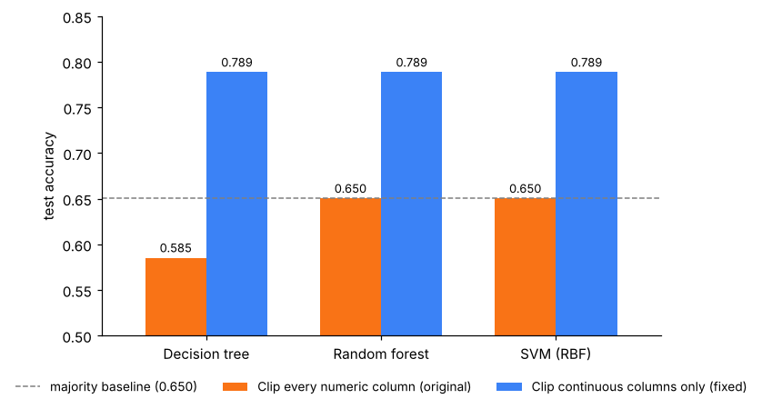
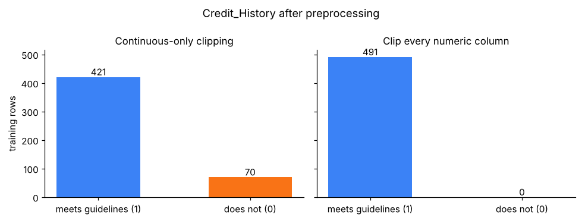

# Credit Risk Analysis: One IQR Rule, Two Dead Features

A case study from revisiting a loan-approval assignment. The original pipeline scored **below the majority-class baseline**. Changing which columns the outlier rule touches, and nothing else, moved test accuracy from **0.585–0.650 to 0.789**.

<p align="center">
  
</p>

## What went wrong

The preprocessing clipped **every numeric column** to `[Q1 − 1.5·IQR, Q3 + 1.5·IQR]`.

- `Credit_History` is binary and 84% of values are 1, so Q1 = Q3 = 1 and IQR = 0. The bounds become `[1, 1]` and every applicant with a bad credit history is rewritten as "meets guidelines".
- `Loan_Amount_Term` (85% are 360 months) collapses to a single value the same way.

That is a problem because `Credit_History` is the strongest signal in the data: applicants who meet the guidelines are approved 79.6% of the time, the others 7.9%.

<p align="center">
  
</p>

## Results

Same 80/20 split (`random_state=42`), 5-fold CV tuning on the training split, test split used once. Preprocessing is fitted inside each CV fold.

| Preprocessing | Model | CV accuracy | Test accuracy | Test macro-F1 |
|---|---|---:|---:|---:|
| Clip every numeric column (original) | Decision tree | 0.666 | 0.585 | 0.418 |
| | Random forest | 0.697 | 0.650 | 0.394 |
| | SVM (RBF) | 0.697 | 0.650 | 0.394 |
| Clip continuous columns only (fixed) | Decision tree | 0.805 | **0.789** | **0.720** |
| | Random forest | 0.815 | **0.789** | **0.720** |
| | SVM (RBF) | 0.815 | **0.789** | **0.720** |

Majority-class baseline on the test split ("always approve"): **0.650**.

The notebook also shows a second, smaller issue from the original work: picking the decision threshold on the test set (0.797) instead of on out-of-fold training predictions (0.789).

## Takeaways

- A generic outlier rule can silently erase a binary or near-constant feature. Checking `nunique()` before and after each preprocessing step catches it.
- Report the majority-class baseline next to accuracy. Without it, 0.65 looked "low but plausible".
- Anything chosen by looking at the test set, thresholds included, makes the test score optimistic.

## Repository

```
├── loan_preprocessing_case_study.ipynb   # full analysis, executed
├── src/preprocessing.py                  # train-only fitted preprocessing (imputation, IQR clipping, encoding)
├── assets/                               # figures used above
└── requirements.txt
```

## Run it

1. Download `train_u6lujuX_CVtuZ9i.csv` from the [Kaggle Loan Prediction Problem Dataset](https://www.kaggle.com/datasets/altruistdelhite04/loan-prediction-problem-dataset) and save it as `data/train.csv`. The data is not redistributed here.
2. Install and run:

```bash
pip install -r requirements.txt
jupyter notebook loan_preprocessing_case_study.ipynb
```
